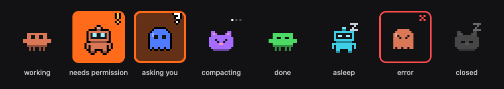

# Perch

<p align="center">
  
</p>

A floating strip on the edge of your Mac's screen with one animated pixel-art creature per Claude Code session. Each creature shows what its session is doing, and the ones waiting for you are hard to miss. Click a creature and its session opens in the Claude desktop app.

> **Not an official Anthropic project.** It is not affiliated with or endorsed by Anthropic. "Claude" is a trademark of Anthropic, PBC.

> **Early development.** The overlay works, but it still relies on the agent from [claude-panel](https://github.com/elrincondeldev/claude-panel) and is built from source. A Homebrew install (`brew install elrincondeldev/tap/perch && perch setup`) is the next milestone.

## Features

- **One creature per session**: pinned sessions first, then running ones by name. Each one animates its session's state: working, needs permission, asking you, compacting, done, error or closed. Finished sessions fall asleep after five minutes.
- **Hard to miss when it needs you**: a permission request blinks the creature's tile in orange; a question rings it in orange.
- **Hover** for the session's name and status, e.g. `Bash: npm test` or `done · 5m`.
- **Click** to open the session in the Claude desktop app, even one the app has stopped. The session in front is ringed in white.
- **Right-click** (or control-click) to pin or unpin the session and pick its character and color.
- **Stays out of the way**: the strip floats over every Space and full-screen app and never takes focus from the app you're using.
- **Menu bar item** to show or hide the strip, move it to the left or right edge, and see how many sessions are waiting for you.

## How it works

```
Claude Code ─ hooks ─▶ agent ◀─ WebSocket (127.0.0.1:7778, token) ─ Perch overlay ─ menu bar
claude agents ─ poll ─▶  └ SQLite: pins, icons
```

- **The agent** tracks every session's state from Claude Code hooks and `claude agents --json`, keeps pins and icons, and opens sessions. For now it is claude-panel's agent, so the Raspberry Pi panel and Perch show the same sessions with the same looks.
- **The overlay** (`perch-overlay`) is a native AppKit and Core Animation app that runs as an accessory: no Dock icon, just the strip and a menu bar item. It costs about 0.5 % of one CPU core and 13 MB of memory while it animates.

## Requirements

- macOS 14 or newer, with the Claude desktop app (sessions in its Code tab)
- Command Line Tools for Xcode (`xcode-select --install`), Swift 5.9 or newer
- [Bun](https://bun.sh) 1.3 or newer and the Claude Code CLI 2.1.285 or newer, for claude-panel's agent

## Build and run from source

1. Install claude-panel's agent. It forwards Claude Code hook events and starts at every login; the Raspberry Pi is optional.
   ```bash
   git clone https://github.com/elrincondeldev/claude-panel.git
   cd claude-panel
   bun run setup
   ```
2. Build and start Perch:
   ```bash
   git clone https://github.com/elrincondeldev/perch.git
   cd perch
   swift build -c release
   nohup .build/release/perch-overlay >/dev/null 2>&1 &
   ```

Quit it from the creature in the menu bar. Only one copy runs at a time.

## Customizing the creatures

The characters are 16×16 text templates in [`Sources/PerchCore/Resources/characters.json`](Sources/PerchCore/Resources/characters.json):

| Field | Meaning |
|---|---|
| `body` | 16 rows of 16 cells: `B` body (the session's color), `D` darker, `L` lighter, `F` face plate, `P` pink, `.` empty |
| `walk` | Optional rows that replace the body from `row` down on alternate frames while the session works |
| `eyes` | Top-left corners of the two 2×2 eyes, which blink, close and squint on their own |
| `eyeColor` | Optional `#rrggbb` |

After editing, check the templates with `swift run PerchCoreTests` and rebuild.

## Development

```bash
swift build                    # debug build: .build/debug/perch-overlay
swift run PerchCoreTests       # unit tests for the protocol, session list, status rules, sprites and layout
```

The Command Line Tools for Xcode 15 ship without XCTest, so the tests are a plain executable that exits non-zero when a check fails.

## Privacy

- The overlay only talks to the agent on 127.0.0.1, with the pairing token from `~/Library/Application Support/claude-panel/config.json`. It sends nothing anywhere else and has no telemetry.
- It stores its edge in the `com.elrincondeldev.perch` defaults and a lock file in `~/Library/Application Support/perch/`.
- The hover label can show tool details such as a shell command, so anyone who can see your screen can read them.

## Roadmap

- The agent moves into Perch, behind one `perch` command with `setup`, `uninstall` and `status`.
- Releases built by GitHub Actions for Apple Silicon and Intel, installed with Homebrew.
- Drag the strip to any edge, collapse it, global shortcuts to open sessions, and notifications when a session needs you.

## License

[MIT](LICENSE)
